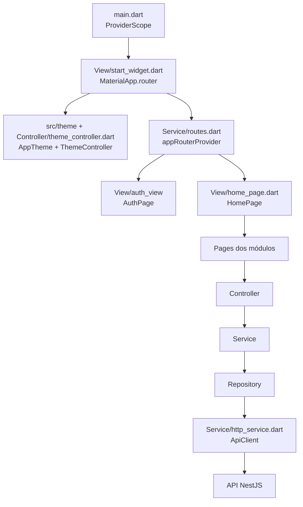
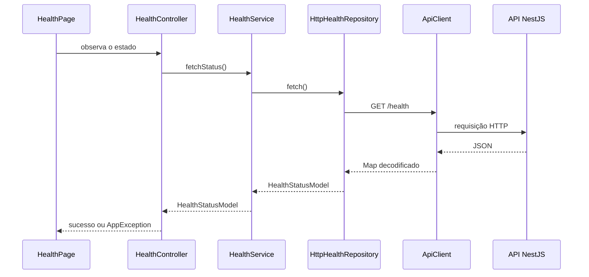

# Fundação da Aplicação

Este documento descreve a base técnica sobre a qual os módulos do Otzar são construídos: o que já existe, onde cada peça vive e como conectar uma nova funcionalidade.

Nenhuma regra de negócio do MVP está implementada. A fundação entrega apenas a estrutura, o tema, a navegação, a infraestrutura HTTP e a verificação de conexão entre frontend e API.

---

# Repositório

```text
C:\GitHub\Otzar\
├── frontend\   # Frontend Flutter
└── backend\    # API REST NestJS
```

---

# Frontend

## Componentes



## Estrutura de pastas

```text
lib/
├── main.dart
├── Model/
│   ├── auth_model/
│   └── health_model/
├── Repository/
│   ├── auth_repository/
│   └── health_repository/
├── Service/
│   ├── routes.dart
│   ├── http_service.dart
│   ├── http_exceptions.dart
│   ├── app_config.dart
│   ├── auth_service/
│   └── health_service/
├── Controller/
│   ├── theme_controller.dart
│   ├── auth_controller/
│   └── health_controller/
├── View/
│   ├── start_widget.dart
│   ├── home_page.dart
│   ├── health_page.dart
│   ├── section_placeholder_page.dart
│   ├── Componentes/
│   └── auth_view/
│       ├── auth_page.dart
│       └── auth_componentes/
└── src/
    └── theme/
```

## Arquivos principais

| Arquivo                                                | Responsabilidade                                                       |
| ------------------------------------------------------ | ---------------------------------------------------------------------- |
| `lib/main.dart`                                         | Apenas o bootstrap: `ProviderScope` e `runApp`.                        |
| `lib/View/start_widget.dart`                            | `MaterialApp.router`, temas e roteador.                                |
| `lib/src/theme/app_colors.dart`                         | Esquemas de cores da identidade visual.                                |
| `lib/src/theme/app_theme.dart`                          | Temas claro e escuro do Material 3.                                    |
| `lib/src/theme/app_text_theme.dart`                     | Tipografia Inter via `google_fonts`.                                   |
| `lib/src/theme/app_breakpoints.dart`                    | Breakpoint global de 900px.                                            |
| `lib/Controller/theme_controller.dart`                  | Preferência de tema, persistida em `shared_preferences`.               |
| `lib/Service/routes.dart`                               | Caminhos das rotas (`AppRoutes`) e configuração do GoRouter.           |
| `lib/Service/app_config.dart`                           | Configuração do ambiente, lida de `--dart-define`.                     |
| `lib/Service/http_service.dart`                         | `ApiClient`: transporte HTTP e tradução de erros.                      |
| `lib/Service/http_exceptions.dart`                      | Falhas conhecidas da aplicação.                                        |
| `lib/View/Componentes/`                                 | Estados de carregando, vazio e erro; navegação principal.              |
| `lib/View/auth_view/` + `Controller/auth_controller/` + `Service/auth_service/` + `Repository/auth_repository/` + `Model/auth_model/` | Jornada de entrada (splash, login stub e sessão em memória). |
| `lib/View/home_page.dart`                               | Shell: barra superior e navegação principal.                           |
| `lib/View/health_page.dart` + `Controller/health_controller/` + `Service/health_service/` + `Repository/health_repository/` + `Model/health_model/` | Verificação de conexão com a API. |

## Tema

O esquema de cores claro e escuro está definido em `AppColors`, exportado do Material Theme Builder (paleta neutra em tons de cinza). A tipografia usa a fonte **Inter** via `google_fonts`, montada em `src/theme/app_text_theme.dart`.

Para trocar a identidade visual, substitua `AppColors.lightScheme()` e `AppColors.darkScheme()` por uma nova paleta exportada do Material Theme Builder. As Views nunca escrevem cores diretamente: obtêm tudo de `Theme.of(context)`.

A preferência entre tema claro e escuro é alternada pela barra superior e persistida localmente.

Campos de texto usam só a linha inferior, sem preenchimento e sem caixa. Em foco, a linha assume a cor primária; em erro, a cor de erro.

## Navegação

A navegação usa `ShellRoute`: a barra superior e a navegação principal permanecem montadas enquanto o conteúdo da rota muda.

O layout se adapta à largura da janela:

| Largura   | Navegação                                     |
| --------- | --------------------------------------------- |
| `< 840`   | `NavigationDrawer` aberto pela barra superior  |
| `>= 840`  | `NavigationRail` recolhido                     |
| `>= 1200` | `NavigationRail` estendido, com rótulos        |

Os itens da navegação principal do MVP seguem `06-ui-ux.md` e `10-mvp.md`: Projetos, Tarefas, Backlog e Tickets. As telas dessas rotas ainda são provisórias (`SectionPlaceholderPage`).

A aplicação abre em `/login`. Sem sessão, qualquer rota do shell volta para `/login`. Com sessão, `/login` vai para `/projetos`. A sessão é só em memória (não há JWT). O comportamento da jornada está em [Login/autenticacao.md](Login/autenticacao.md).

O corte de layout da autenticação é **900px** (`AppBreakpoints.medium`). O shell continua nos limiares **840** e **1200** descritos acima.

## Comunicação com a API

O endereço da API não fica fixo no código:

```powershell
flutter run -d chrome --dart-define=API_URL=http://localhost:3000
```

Sem o parâmetro, `AppConfig.apiUrl` assume `http://localhost:3000`.

O `ApiClient` conhece apenas transporte. Ele converte qualquer falha em uma `AppException`:

| Falha                                   | Exceção                        |
| --------------------------------------- | ------------------------------ |
| Sem conexão, servidor fora do ar, timeout | `NetworkException`             |
| A API respondeu com erro                 | `ApiException` (com `statusCode`) |
| A API respondeu conteúdo inválido        | `UnexpectedResponseException`  |

A mensagem da `ApiException` vem do campo `message` devolvido pelo backend, de modo que a interface exibe o texto definido pela API.

Os Repositories traduzem o JSON em Models. Os Controllers expõem `AsyncValue` e as Pages tratam carregando, sucesso e erro com os widgets de `View/Componentes`.

## Diagnóstico

O ícone de diagnóstico na barra superior abre `/diagnostico`, que consulta `GET /health` percorrendo o caminho real da arquitetura:



Esta tela existe para validar o ambiente e serve como exemplo mínimo do fluxo entre camadas.

---

# Backend

A fundação do backend (bootstrap, Prisma, formato de erros, `GET /health` e como adicionar módulos) está documentada em [`backend/docs/arquitetura/fundacao.md`](../../backend/docs/arquitetura/fundacao.md).

O ambiente de desenvolvimento do backend está em [`backend/docs/ambiente-de-desenvolvimento.md`](../../backend/docs/ambiente-de-desenvolvimento.md).

---

# Como adicionar um novo módulo

Seguir `.cursor/rules/flutter-estrutura-do-projeto.mdc`. Exemplo com `tasks`:

1. Criar o Model em `lib/Model/tasks_model/task_model.dart` com Freezed e rodar `dart run build_runner build`.
2. Criar o Repository em `lib/Repository/tasks_repository/task_repository.dart`, com a interface `ITaskRepository` e a implementação `HttpTaskRepository`, injetando `apiClientProvider`.
3. Criar o Service em `lib/Service/tasks_service/task_service.dart`, recebendo `ITaskRepository`. O Service sempre existe, mesmo quando apenas repassa a chamada (como o `HealthService`).
4. Criar o Controller em `lib/Controller/tasks_controller/task_controller.dart`, expondo `AsyncValue`.
5. Criar a Page em `lib/View/tasks_page.dart` ou, se houver componentes próprios, em `lib/View/tasks_view/tasks_page.dart` com os widgets em `tasks_componentes/`. Tratar carregando, vazio, sucesso e erro.
6. Registrar a rota em `lib/Service/routes.dart`, substituindo a `SectionPlaceholderPage` correspondente.
7. Criar os testes em `test/`, espelhando a camada (`test/Repository/tasks_repository/`, `test/Controller/tasks_controller/`).
8. Criar o módulo equivalente no backend, conforme [`backend/docs/arquitetura/fundacao.md`](../../backend/docs/arquitetura/fundacao.md).

O backend continua sendo a única fonte de verdade das regras de negócio, conforme `07-arquitetura.md`.

---

# Fora da fundação

Não fazem parte desta etapa e serão implementados junto com os módulos:

* Autenticação real na API (JWT). A jornada visual e o redirect usam sessão em memória;
* Entidades do domínio no schema do Prisma;
* Telas reais de Projetos, Tarefas, Backlog e Tickets;
* Visualização Kanban;
* Deploy no Render.
